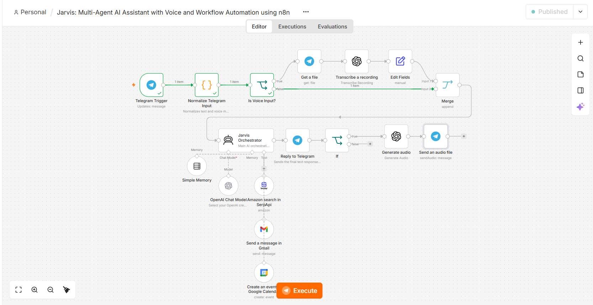
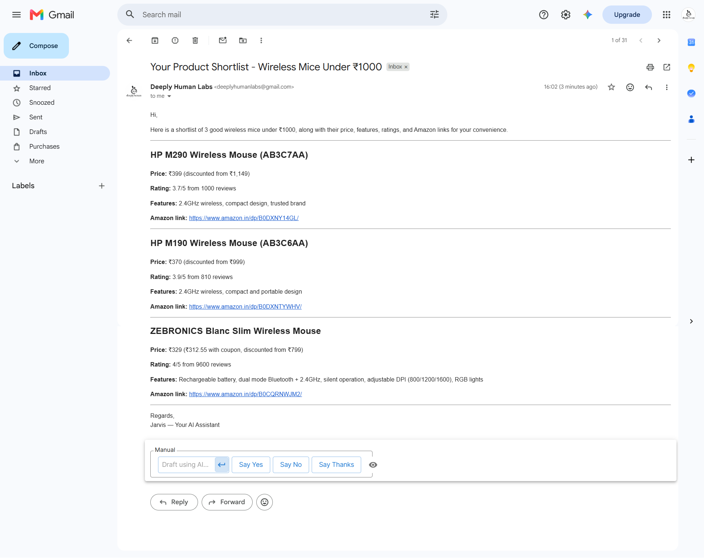
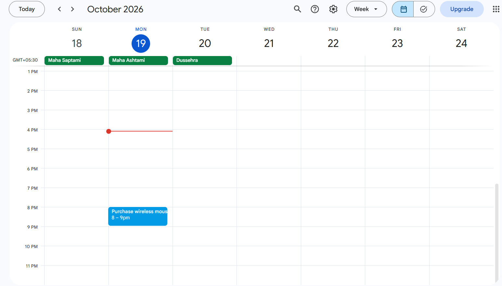

# Jarvis: Voice-Enabled Multi-Agent AI Assistant

Jarvis is a Telegram-based AI assistant built with n8n that combines product research, contextual email delivery, calendar reminders, and voice interaction in a single conversational workflow.

It is designed as a practical personal assistant: users can ask questions by text or voice, research products from Amazon India, request a formatted shortlist by email, and prepare calendar reminders with explicit confirmation before an event is created.

## Demo

### User Demo

[Watch the user demo](https://github.com/user-attachments/assets/764ddba4-9c80-421b-87ca-78b894470e0b)

### Workflow Walkthrough

[Watch the n8n workflow walkthrough](https://github.com/user-attachments/assets/0557e146-4aa8-48e5-989f-e78d51d062ba)

## Screenshots

<table>
  <tr>
    <td width="33.33%" align="center">
      
      <br><sub>Multi-agent workflow in n8n</sub>
    </td>
    <td width="33.33%" align="center">
      
      <br><sub>Formatted Gmail shortlist</sub>
    </td>
    <td width="33.33%" align="center">
      
      <br><sub>Google Calendar reminder</sub>
    </td>
  </tr>
</table>

## Capabilities

- **Telegram interface:** Interact with Jarvis through Telegram messages.
- **Voice-enabled interaction:** Voice messages are transcribed to text, processed by Jarvis, and answered with both a text response and generated audio.
- **Multi-agent orchestration:** An AI agent routes requests to the relevant tools for product research, email delivery, calendar actions, or general questions.
- **Amazon India product research:** Search for products and compare options using the configured search integration. Search results are discovery data, not guaranteed live stock or verified pricing.
- **Email delivery with approval:** Jarvis offers to email a product shortlist and sends it through Gmail only after the user clearly approves. It asks for the recipient address if it is unknown.
- **Calendar reminders with confirmation:** Jarvis proposes the event title, date, and time before creating a Google Calendar event. Relative dates use the workflow's runtime date and the `Asia/Kolkata` timezone.
- **Conversational context:** n8n Simple Memory provides context across turns, subject to the workflow's configured memory behavior.

## How It Works

1. **Receive a Telegram update.** The workflow normalizes incoming text or voice messages and identifies the chat and message type.
2. **Transcribe voice input.** Voice messages are retrieved from Telegram and transcribed with OpenAI speech-to-text.
3. **Orchestrate the request.** The Jarvis AI agent uses GPT-4.1 mini and its connected tools to handle the user's request.
4. **Research products when needed.** The configured SerpApi Amazon search integration retrieves product discovery results for comparison.
5. **Deliver approved email.** The Gmail tool sends a formatted shortlist after contextual user approval.
6. **Create confirmed calendar events.** The Google Calendar tool is used only after the user confirms the proposed event details.
7. **Respond in the appropriate format.** Text requests receive text replies. Voice requests receive a text reply followed by generated audio using OpenAI text-to-speech, delivered through Telegram.

## Technology Stack

| Component | Technology |
|---|---|
| Workflow automation and orchestration | n8n |
| Conversational interface | Telegram Bot API |
| Main language model | OpenAI GPT-4.1 mini |
| Speech-to-text | OpenAI Audio Transcription |
| Text-to-speech | OpenAI Audio Generation |
| Product search | SerpApi Amazon Search |
| Email delivery | Gmail |
| Calendar integration | Google Calendar |
| Conversational memory | n8n Simple Memory |

## Workflow Design

The workflow combines deterministic n8n nodes with an AI agent and connected tools. Telegram message normalization and voice routing are handled in workflow nodes, while the agent selects the connected capability relevant to the request.

External actions have explicit safeguards:
- Gmail delivery requires clear approval of the shortlist email.
- Calendar creation requires confirmation of the proposed event details.
- An action should be reported as completed only after the relevant integration succeeds.

## Setup Overview

This repository contains the exported n8n workflow JSON and supporting demo assets.

1. Import `n8n-jarvis-voice-enabled-multi-agent-assistant.json` into n8n.
2. Configure credentials for Telegram, OpenAI, Gmail, Google Calendar, and SerpApi as required by the workflow.
3. Review the connected tool settings, model configuration, and Telegram bot permissions.
4. Verify the runtime timezone is set to `Asia/Kolkata` for calendar interpretation.
5. Test text messages, voice messages, product search, email approval, and calendar confirmation before enabling regular use.

**Security:** Configure credentials in n8n's credential manager. Do not commit API keys, access tokens, OAuth secrets, or personal data to the repository.

## Project Structure

```text
n8n-jarvis-voice-enabled-multi-agent-assistant/
├── n8n-jarvis-voice-enabled-multi-agent-assistant.json
└── screenshots/
    ├── n8n-workflow.png
    ├── gmail.png
    ├── calendar.png
    ├── demo.mp4
    └── workflow.mp4
```

## Notes and Limitations

- Amazon search results are discovery results; prices, availability, ratings, and review counts may change.
- Email and calendar operations depend on valid credentials and tool configuration.
- Voice responses depend on successful transcription and audio-generation steps.
- Simple Memory is not a substitute for a durable database or workflow state store. Pending approvals should not be treated as permanently persisted unless a dedicated state mechanism is implemented.

## License

No license has been specified yet.
